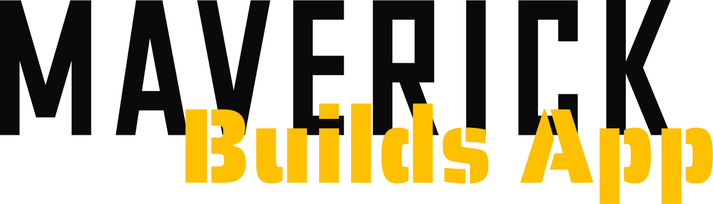
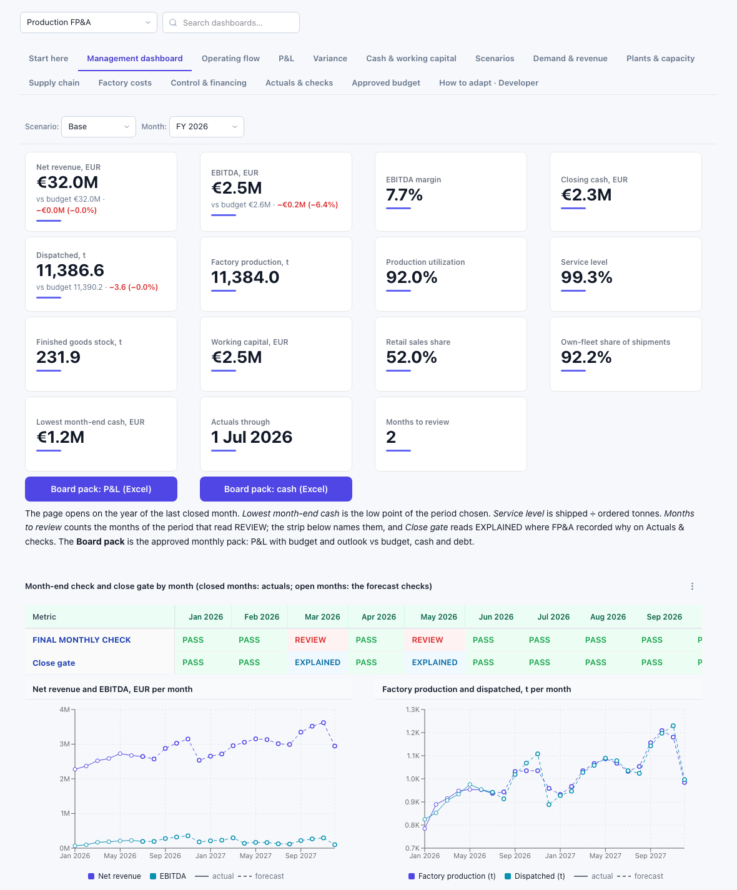

<div align="center">

<a href="https://maverickbuilds.app">
  <picture>
    <source media="(prefers-color-scheme: dark)" srcset="docs/assets/wordmark-dark.svg">
    
  </picture>
</a>

### Turn your spreadsheets into planning and analytics apps, built with an AI developer and ready for Claude and ChatGPT.

[](https://github.com/Mavericka-SARL/maverick-builds-app/releases)
[](LICENSE)
[](https://github.com/Mavericka-SARL/maverick-builds-app/actions/workflows/ci.yml)
[](https://github.com/Mavericka-SARL/maverick-builds-app/discussions)
[](https://app.maverickbuilds.app/signup)

[Website](https://maverickbuilds.app) ·
[Playground](https://app.maverickbuilds.app/signup) ·
[Docs](docs/README.md) ·
[YouTube demo](https://www.youtube.com/watch?v=NSS7vX4LDKI) ·
[Roadmap](https://github.com/orgs/Mavericka-SARL/projects/1)

<a href="https://www.youtube.com/watch?v=NSS7vX4LDKI">
  
</a>

<sub>A management dashboard built on one model: KPIs against budget, the month-end close gate and monthly trends. Click it for the demo video.</sub>

</div>

maverickbuilds.app turns spreadsheets into decision-making apps for planning
and analytics: budgets, forecasts, targets and headcount plans the whole
business works in.

- **Multidimensional models**: regions, products, cost centres and time with
  totals on every level and spreadsheet-style formulas.
- **Integrations**: Excel and CSV files, Google Sheets, REST APIs and SFTP
  folders on a schedule; grid exports as CSV, XLSX or JSON.
- **Roles and workflows**: roles defined by the business with access down to
  each member and metric, and approval steps with due dates and reminders.
- **Dashboards and chat with data**: charts, KPIs and live tables, plus an
  MCP server so Claude and ChatGPT can answer questions from the grids and
  records, enter values and update records, with each person's own access.
- **AI developer**: builds models, forms, dashboards and workflows together
  with you as a plan to review, on OpenAI, Anthropic, Google, Mistral or
  DeepSeek at no mark-up.
- **Revisions**: each change built and tested in its own revision and
  published in one step; models move between workspaces by export and import.

It is built with Go, React and PostgreSQL. The architecture is described in
[ARCHITECTURE.md](ARCHITECTURE.md), and every document is indexed in
[docs/README.md](docs/README.md).

## Get started in 60 seconds

**1. Try it hosted.** [Sign up for the Playground](https://app.maverickbuilds.app/signup):
the Community Edition run for you, hosted in the EU, free up to 100 MB with
no time limit. Start from your own spreadsheet, or import a ready-made model
from [Discussions › Models](https://github.com/Mavericka-SARL/maverick-builds-app/discussions/categories/models).

**2. Self-host it with Docker Compose.** One server, the published images for
x86-64 and ARM, no build:

```bash
git clone https://github.com/Mavericka-SARL/maverick-builds-app.git maverickbuilds
cd maverickbuilds
git checkout 2026.11.25.1          # a release: the newest is on the Releases page
cd deploy/compose
./setup.sh env                     # creates .env with random secrets; set the host names in it
docker compose pull
docker compose up -d
```

[docs/SELF_HOSTING.md](docs/SELF_HOSTING.md) has the whole path: the settings
to fill in, trying it on your own computer, Kubernetes, backups and upgrades.

**3. Connect Claude or ChatGPT.** In the console, the account menu (top right)
→ **Connect ChatGPT or Claude** shows the connector URL and each host's
client ID and secret. Add it as a connector in Claude or ChatGPT, and ask
about your grids and records in the chat, with your own access.
[docs/CHAT_CONNECTOR.md](docs/CHAT_CONNECTOR.md) lists every tool.

## Why maverickbuilds.app

- **No per-user licence.** No edition is licensed per user. The Community
  Edition is free to self-host for your company's internal use with
  unlimited users, so everyone who plans can work in the model.
- **Chat with your planning data.** Claude and ChatGPT read the grids,
  records, dashboards and workflows as the signed-in person, make charts and
  reports, and enter values only where that person may.
- **Run it on your own servers.** Docker Compose on one server or Kubernetes,
  with your data in your own PostgreSQL. The source is public, so you can read
  exactly what runs.

## How it compares

| | maverickbuilds.app | Excel or Google Sheets | Anaplan | Pigment | Causal |
|---|---|---|---|---|---|
| Multidimensional models with totals on every level | Yes | No, two-dimensional sheets | Yes | Yes | Yes |
| Run it on your own servers | Yes, Docker Compose or Kubernetes | Excel files only | No, cloud only | No, cloud only | No, cloud only |
| Source code you can read | Yes, [source-available](LICENSE) | No | No | No | No |

<sub>Compared from the vendors' public pages as of November 2026. Causal is
part of Lucanet since 2024. Something out of date? [Open an
issue](https://github.com/Mavericka-SARL/maverick-builds-app/issues/new/choose).</sub>

## Develop the platform

The rest of this page is about developing the platform. The quick start below
runs it in development mode, where anyone can act as any user, so it must
never face a network you do not trust. To run it for real, follow
[docs/SELF_HOSTING.md](docs/SELF_HOSTING.md): each release on the Releases
page comes with ready-built images (`ghcr.io/mavericka-sarl/mavericks/*`,
x86-64 and ARM).

### Current runtime

The primary local runtime is:

```text
React/Vite web app :5173
        |
        | /api via Vite proxy
        v
Go HTTP gateway :8080
        |
        v
PostgreSQL :5432
```

The gateway serves the whole browser API and runs the domain packages
in-process. The integration worker, which runs connector syncs, is the only
other program; see [Runtime topology](ARCHITECTURE.md#runtime-topology).

### Prerequisites

- Go 1.26.9, matching `go.mod`
- Node.js 24, matching CI
- Docker with Compose v2
- npm
- optional code-generation tools: Buf and ogen

### Quick start

Start PostgreSQL and the supporting local infrastructure:

```bash
make dev-up
```

Start the API in development-persona mode:

```bash
bash dev.sh
```

With the gateway running, create the platform administrator persona the seeds
start as (once per database), then seed the reference demo through its HTTP
API, the way a real developer would build it:

```bash
make dev-admin
go run ./cmd/seed-regional-planning
```

The other seeds are listed in [docs/DEVELOPMENT.md](docs/DEVELOPMENT.md#demo-seeds).

In a second terminal, start the web application:

```bash
cd web
npm ci
VITE_DEV_MODE=true npm run dev
```

Open <http://localhost:5173>. The frontend proxies `/api` to
`http://localhost:8080`. Use the persona switcher in the shell footer to change
roles in development mode.

`make dev-up` starts infrastructure only: PostgreSQL, PgBouncer, Keycloak,
and MinIO. It does not start the Go gateway or the web application.

### Verification

The CI-equivalent checks are:

```bash
go test -race -coverprofile=coverage.out ./...
go build ./...
golangci-lint run ./...
buf lint
ogen --target internal/gateway/oas --package oas --clean api/openapi.yaml

cd web
npm ci
npx eslint src/
npx tsc -b --noEmit
npm run e2e
npm run build
```

The ogen step is a drift check: generated files must remain unchanged
after generation.

### Repository map

| Path | Purpose |
|---|---|
| `cmd/` | HTTP gateway, integration worker, command-line tools, verification harnesses, and demo seeds |
| `internal/gateway/` | Browser-facing HTTP API and current composition root |
| `internal/` | Domain packages for model editing, formula, calculation, query, workflow, import, integrations, identity, access checks, AI, editions, deployment, and supporting services |
| `pkg/` | Shared configuration, database, tenant routing, licence, logging, migration, object storage, and telemetry helpers |
| `migrations/` | Ordered PostgreSQL schema history embedded into Go binaries |
| `proto/` and `gen/go/` | Protobuf definitions of stored workflow, import, notification and calculation types, and their generated Go code |
| `api/openapi.yaml` | OpenAPI contract for every gateway route, held to the router by a CI test; generates `internal/gateway/oas` |
| `web/` | React 19, TypeScript, Vite, React Query, Recharts, and Playwright application |
| `deploy/compose/` | The self-hosted single-server stack (docs/SELF_HOSTING.md) |
| `deploy/docker/` | Dockerfiles, local development infrastructure and optional observability stack |
| `deploy/k8s/` | Base manifests and example overlays for running on Kubernetes (docs/SELF_HOSTING.md) |
| `examples/` | Model packages to import and try, and how to share your own |
| `docs/` | Current documentation index and engineering guides |

## Editions and licensing

maverickbuilds.app is one code base in three editions. The Community Edition is
licensed under the [Sustainable Use License](LICENSE) for internal use only:
your company runs and modifies it for its own operations and may share the
reports and exports it produces with anyone, but nobody outside the company
may sign in to it, and building on it for clients, hosting it for others or
reselling it needs a Commercial licence. The Commercial Edition adds those
rights and white-labelling; the Enterprise Edition adds features
such as single sign-on, audit export and per-cell history. The code of those
enterprise features lives under [`ee/`](ee/README.md) under the
[Enterprise Features License](ee/LICENSE): every build and image contains
it, switched off until a signed, offline license key switches it on; see
[docs/LICENSING.md](docs/LICENSING.md).

## Community

- **Share a model:** export it definitions only and post it in
  [Show and tell](https://github.com/Mavericka-SARL/maverick-builds-app/discussions/categories/show-and-tell);
  [examples/](examples/README.md) has one to import and the steps.
- **Report a bug:** [open an issue](https://github.com/Mavericka-SARL/maverick-builds-app/issues/new/choose).
- **Suggest a feature:** post or upvote it in
  [Ideas](https://github.com/Mavericka-SARL/maverick-builds-app/discussions/categories/ideas);
  what we take on is on the [roadmap board](https://github.com/orgs/Mavericka-SARL/projects/1).
- **Ask a question:** [Q&A](https://github.com/Mavericka-SARL/maverick-builds-app/discussions/categories/q-a).

[CONTRIBUTING.md](CONTRIBUTING.md) has the details.

## Main documentation

- [Architecture](ARCHITECTURE.md)
- [Self-hosting: deploy on your own infrastructure](docs/SELF_HOSTING.md)
- [Documentation index and status](docs/README.md)
- [Development and validation](docs/DEVELOPMENT.md)
- [HTTP API guide](docs/API.md)
- [Chat with your data: the ChatGPT and Claude connector](docs/CHAT_CONNECTOR.md)
- [The AI developer](docs/AI_DEVELOPER.md)
- [Editions and licensing](docs/LICENSING.md)
- [Contributing](CONTRIBUTING.md), the [code of conduct](CODE_OF_CONDUCT.md) and
  [reporting a security issue](SECURITY.md)
- [Editions and self-service sign-up](docs/EDITIONS_AND_SIGNUP.md)
- [Terms of service and privacy notice](docs/LEGAL_AND_PRIVACY.md)
- [The product's look](docs/BRAND.md)
- [Staging and load testing](docs/STAGING_AND_LOAD_TESTING.md)
- [A database per tenant](docs/TENANT_DATABASES.md)
- [Notifications and reminders](docs/NOTIFICATIONS.md)
- [Web application](web/README.md)
- [UI design system](web/src/ui/DESIGN_SYSTEM.md)

---

<div align="center">

**If this saves you a spreadsheet, a star helps others find it.** ⭐

<!-- Star history: add once the repository passes about 50 stars.
[](https://star-history.com/#Mavericka-SARL/maverick-builds-app&Date)
-->

</div>
